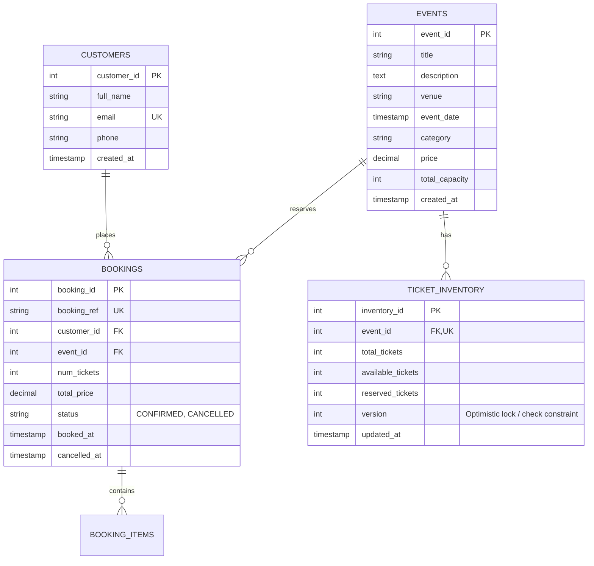

# System Architecture & Technical Specification

**Project:** Scalable Online Ticket Booking Database Using Amazon Aurora  
**Engine:** Amazon Aurora PostgreSQL 16.8 (Compatible with PostgreSQL 16)  
**Backend:** Python 3.14 / Flask / Psycopg2  
**Frontend:** HTML5, Modern CSS, Vanilla JavaScript  
**Infrastructure as Code:** AWS CloudFormation  

---

## 1. Architectural Overview

The core objective of this project is demonstrating **read/write split routing** using Amazon Aurora's purpose-built distributed storage architecture and connection endpoints. 

In traditional relational databases, single instances handle both heavy read workloads (browsing events, querying seat availability, reviewing booking histories) and write workloads (booking tickets, executing payments, inventory decrements). Under peak ticketing events (e.g., concert drops), write locks and read queries compete for resources, leading to latency degradation and timeouts.

Amazon Aurora decouples compute and storage into a distributed 6-way replicated storage fleet across 3 Availability Zones, allowing read replicas to access the same underlying storage volume with sub-10 millisecond replica lag.

```
                                 [ Client Browser / Load Generator ]
                                                  |
                                                  v
                                     [ Flask Application Backend ]
                                     /                         \
                   (Mutations: Book/Cancel)             (Reads: Browse/Stats)
                                   /                             \
                                  v                               v
                       +----------------------+        +----------------------+
                       | Aurora Writer Cluster|        | Aurora Reader Cluster|
                       |       Endpoint       |        |       Endpoint       |
                       +----------------------+        +----------------------+
                                  |                               |
                                  v                               v
                       +----------------------+        +----------------------+
                       |   DBWriterInstance   |        |DBReaderReplicaInstance|
                       |  (Primary - Tier 0)  |        |  (Replica - Tier 1)  |
                       +----------------------+        +----------------------+
                                  \                               /
                                   \                             /
                        +---------------------------------------------+
                        |  Shared Aurora Distributed Storage Volume   |
                        | (Auto-expanding, 6 copies across 3 AZs)    |
                        +---------------------------------------------+
```

---

## 2. Aurora Endpoint Routing Architecture

### 2.1 The Two Endpoints

1. **Cluster Writer Endpoint** (`${ClusterName}.cluster-${Id}.${Region}.rds.amazonaws.com`):
   - Always resolves via DNS to the current primary DB instance.
   - Handles all SQL DDL and DML write operations: `INSERT`, `UPDATE`, `DELETE`, table locks, and inventory mutations.
   - Enforces ACID isolation and row-level locks.

2. **Cluster Reader Endpoint** (`${ClusterName}.cluster-ro-${Id}.${Region}.rds.amazonaws.com`):
   - Resolves to a DNS CNAME that load-balances connections across all active Aurora Read Replicas.
   - Handles read-only SQL queries (`SELECT`).
   - If no read replicas are active, Aurora automatically routes traffic to the primary writer instance to ensure continuous availability.

### 2.2 Application Routing Implementation

In `app.py`, connections are managed explicitly via two dedicated connection helpers:

```python
# app.py connection helpers
def get_writer_conn():
    """Routes to the Primary Aurora Writer instance."""
    return _get_pg_conn(AURORA_WRITER_HOST)

def get_reader_conn():
    """Routes to the Aurora Reader cluster endpoint."""
    return _get_pg_conn(AURORA_READER_HOST)
```

Each API route explicitly chooses its endpoint based on operational intent:

| API Route | HTTP Method | Endpoint Used | Purpose |
|---|---|---|---|
| `/api/events` | GET | **Reader Endpoint** | Event browsing & catalog search |
| `/api/events/<id>` | GET | **Reader Endpoint** | Single event details & inventory check |
| `/api/bookings` | GET | **Reader Endpoint** | User booking history lookups |
| `/api/stats` | GET | **Reader Endpoint** | Performance and database telemetry |
| `/api/book` | POST | **Writer Endpoint** | Ticket purchasing, inventory reservation |
| `/api/cancel` | POST | **Writer Endpoint** | Ticket cancellation, inventory restitution |

### 2.3 Clarification on Reader Endpoint Mechanics

> [!NOTE]
> **Key Academic Distinction:**
> - The Aurora reader endpoint performs **DNS-based connection round-robin** among available read replicas; it does *not* load-balance individual queries within a single persistent connection.
> - Offloading read queries to replicas frees the Primary Writer's CPU, buffer pool, and lock manager to process high-throughput booking transactions.
> - Read replicas do not guarantee individual queries will execute faster than on the writer; rather, they provide **horizontal throughput scalability** under concurrent user load.

---

## 3. Database Schema Design & Normalization

The schema is structured in Third Normal Form (3NF) to guarantee transactional integrity:



---

## 4. Concurrency Control & Overselling Prevention

Ticket booking systems face the **hot-spot overselling problem**: when an event has only 2 tickets left and 50 users click "Book Now" at the same millisecond.

### 4.1 Row-Level Pessimistic Locking (`SELECT ... FOR UPDATE`)

To ensure mathematical impossibility of overselling:

1. A transaction begins on the **Writer Endpoint**:
   ```sql
   BEGIN;
   ```
2. The inventory row for the specific event is locked immediately:
   ```sql
   SELECT available_tickets FROM ticket_inventory 
   WHERE event_id = %s FOR UPDATE;
   ```
3. If `available_tickets < requested_tickets`, the transaction rolls back immediately with HTTP 409 Conflict:
   ```sql
   ROLLBACK;
   ```
4. If tickets are available, the inventory is atomically decremented:
   ```sql
   UPDATE ticket_inventory 
   SET available_tickets = available_tickets - %s,
       updated_at = NOW()
   WHERE event_id = %s;
   ```
5. The customer record is upserted, the booking record is created, and the transaction commits:
   ```sql
   COMMIT;
   ```

### 4.2 Database Check Constraints (Defense in Depth)

Even if application code suffered a logic bug, the PostgreSQL schema enforces a database-level integrity constraint:
```sql
ALTER TABLE ticket_inventory 
ADD CONSTRAINT chk_available_non_negative CHECK (available_tickets >= 0);
```
Any transaction attempting to drive `available_tickets` below 0 raises an immediate database exception, preventing overselling at the storage engine level.

---

## 5. Security Architecture

1. **Port Restriction:** PostgreSQL port 5432 is restricted to the specific authorized CIDR block (`AllowedCidr`). Ingress from `0.0.0.0/0` is strictly forbidden.
2. **Secrets Manager:** The master database password is generated with 24 high-entropy random characters in AWS Secrets Manager using dynamic CloudFormation references (`{{resolve:secretsmanager:...}}`).
3. **No Hardcoded Secrets:** `.env` is listed in `.gitignore`. Local mock mode allows developers to test without AWS credentials.
4. **Encrypted in Transit & Rest:** Aurora storage is encrypted using AWS KMS (`StorageEncrypted: true`). Connection traffic requires TLS/SSL (`sslmode=require`).
